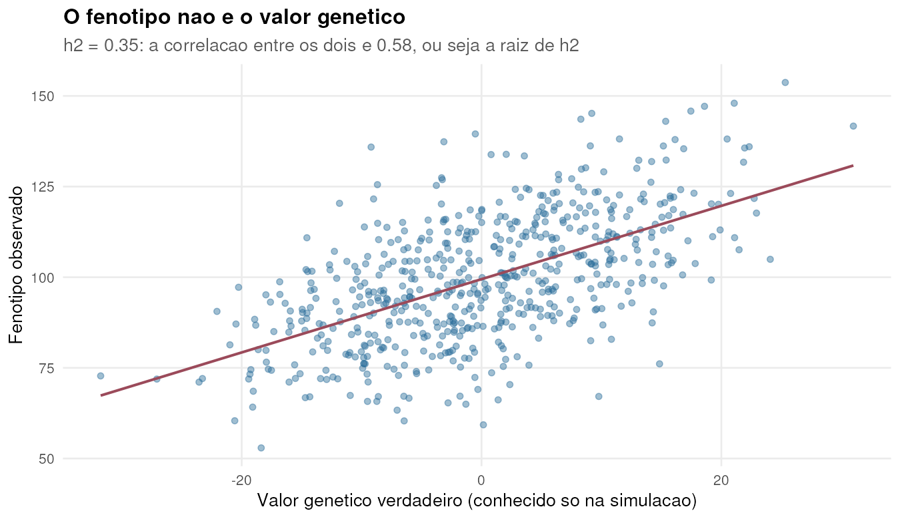
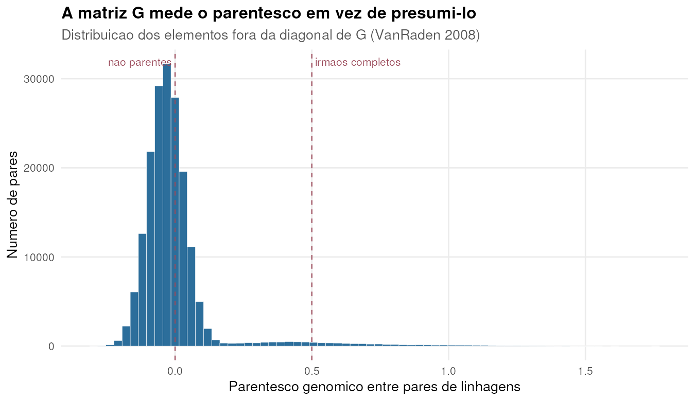
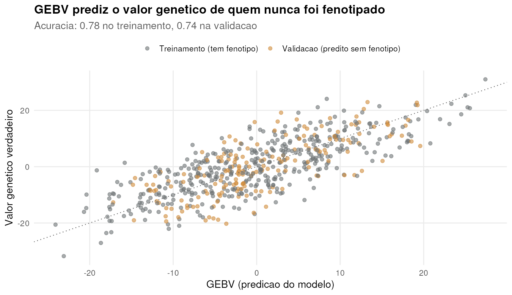
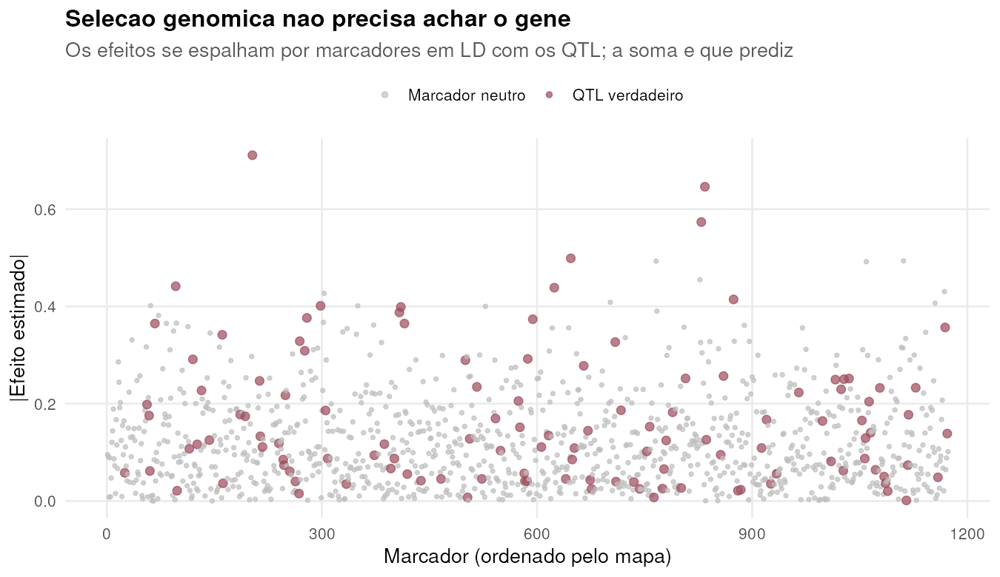
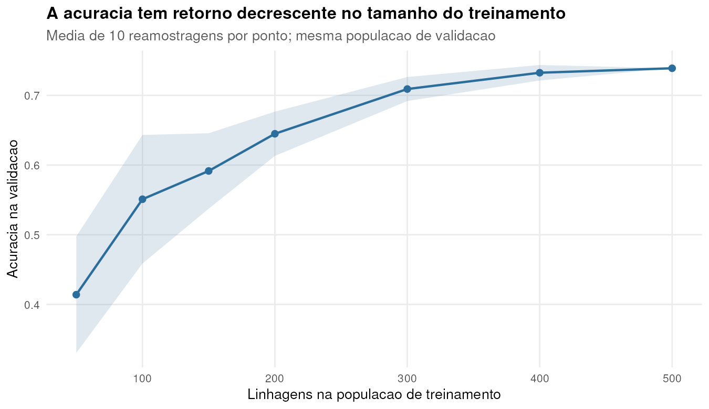
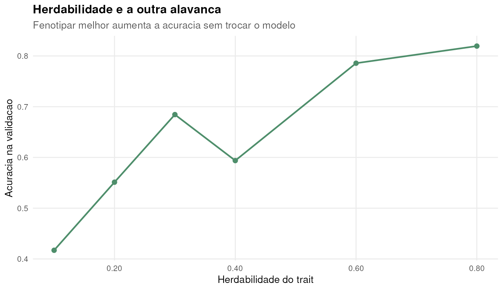
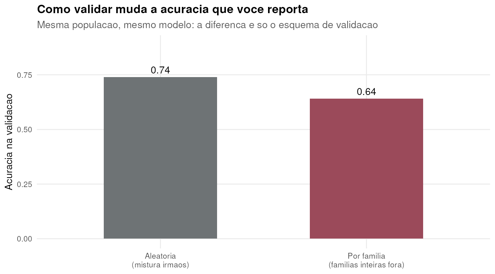
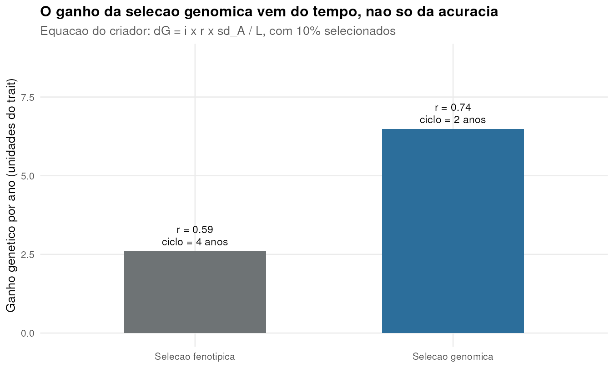
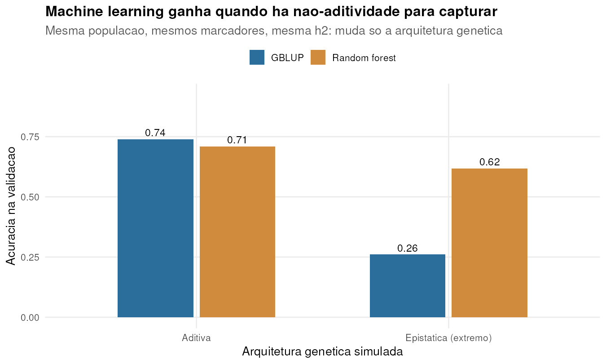

```{r}
#| include: false
#| eval: true
R <- readRDS("resultados_06.rds")
fmt <- function(x, d = 2) formatC(x, format = "f", digits = d, big.mark = ".",
                                  decimal.mark = ",")
```

## O que vamos fazer nestas duas horas

::: {.incremental}
1. **Montar uma população** do zero — fundadores, cruzamentos, marcadores
2. **Medir parentesco** com DNA em vez de pedigree
3. **Predizer** o valor genético de linhagens nunca fenotipadas
4. **Descobrir o que governa a acurácia** — e o que não governa
5. **Traduzir acurácia em ganho genético por ano**
6. **Comparar** o modelo linear com machine learning, no mesmo dado
:::

::: {.callout-note}
Todos os dados desta aula são **simulados**. Nenhum dado real, de nenhuma empresa,
é utilizado. O código roda em R base e está disponível para vocês reusarem.
:::

## Por que simular?

:::: {.columns}
::: {.column width="50%"}
**Em dados reais** você nunca vê o valor genético verdadeiro. Só vê o fenótipo,
que é o valor genético somado a tudo o que o campo faz com a planta.

Resultado: você **não consegue medir** se sua predição está certa — só estimar
indiretamente.
:::
::: {.column width="50%"}
**Na simulação** você define o valor genético. Então pode perguntar:

- A predição acertou?
- Quanto a mais acertaria com o dobro de dados?
- Este modelo novo é melhor mesmo?

É um laboratório onde a verdade é conhecida.
:::
::::

# Parte 1 · A população {background-color="#2C6E9B"}

## Do fundador à linhagem

Quatro passos, cada um com uma decisão biológica embutida:

```{r}
mapa    <- criar_mapa(n_snp = 1500, n_chr = 10)     # 1. onde estão os marcadores
fund    <- simular_fundadores(n_ind = 100, mapa)    # 2. 100 linhagens fundadoras
pop     <- cruzar_dh(fund, pai, mae, n_prog = 6,    # 3. 100 cruzamentos
                     mapa, chr_idx)
Z       <- dosagem(pop)                             # 4. matriz 600 x 1500 de 0 e 2
```

. . .

**O mapa genético não é decoração.** Sem posição não existe recombinação, e sem
recombinação todos os marcadores de um cromossomo carregariam a mesma informação.
É a meiose que quebra os blocos e cria o desequilíbrio de ligação que a seleção
genômica explora.

## Controle de qualidade: o passo invisível

```{r}
maf <- pmin(colMeans(Z) / 2, 1 - colMeans(Z) / 2)
Z   <- Z[, maf >= 0.05]
```

::: {.fragment}
`r R$pop$removidos_maf` dos `r R$pop$n_snp_bruto` marcadores saíram — perderam
polimorfismo na amostra. Sobraram **`r R$pop$n_snp_qc`**.
:::

::: {.fragment}
Em um programa real o QC é onde mora a maior parte do tempo de análise: marcador
com muita falha, amostra trocada, duplicata, sexo incoerente, placa com viés.
**Nenhum modelo recupera dado mal curado** — e é exatamente aqui que um assistente
de IA economiza mais horas, porque é trabalho repetitivo e verificável.
:::

## O problema central do melhoramento

```{r}
#| eval: true
#| echo: false
#| out-width: "78%"

```

::: {.notes}
A correlação entre fenótipo e valor genético é a raiz de h2. Com h2 = 0,35 isso dá 0,59.
Selecionar pelo fenótipo é selecionar com 59% de sinal e 41% de ruído.
:::

## A matriz G: parentesco medido

$$\mathbf{G} = \frac{\mathbf{Z}_c \mathbf{Z}_c'}{2\sum p_j(1-p_j)}$$

```{r}
matriz_G <- function(Z, p = NULL, blend = 0.02) {
  if (is.null(p)) p <- colMeans(Z) / 2
  Zc <- sweep(Z, 2, 2 * p, "-")          # centra nas frequências alélicas
  G  <- tcrossprod(Zc) / (2 * sum(p * (1 - p)))
  (1 - blend) * G + blend * diag(nrow(G))   # blend garante inversa
}
```

. . .

**Pedigree diz o parentesco esperado. G diz o realizado.** Dois irmãos completos
têm parentesco esperado de 0,5, mas o sorteio da meiose faz um par compartilhar
0,42 e outro 0,58. O DNA enxerga essa diferença; o pedigree, não.

## {.smaller}

```{r}
#| eval: true
#| echo: false
#| out-width: "80%"

```

Diagonal média `r fmt(R$G_resumo["diag_media"])` · fora da diagonal
`r fmt(R$G_resumo["fora_media"])` · máximo `r fmt(R$G_resumo["fora_max"])`

# Parte 2 · Do fenótipo ao GEBV {background-color="#2C6E9B"}

## Treinamento e validação

```{r}
idx_ts <- sample(1:600, 420)              # 70% treina
idx_vs <- setdiff(1:600, idx_ts)          # 30% só confere
```

::: {.callout-important}
## A regra que não se quebra
O fenótipo da validação **não entra** no ajuste do modelo. Ele existe apenas para
conferir a predição depois. Se entrar — mesmo indiretamente, numa pré-seleção de
marcadores ou na escolha de um parâmetro — a acurácia que você reporta é ficção.
:::

::: {.fragment}
Este é o erro mais comum em trabalhos que comparam modelos: a preparação do dado
usa a amostra inteira, e só o ajuste final respeita a divisão.
:::

## GBLUP pelas equações do modelo misto

$$y = \mathbf{1}\mu + \mathbf{Z}g + e, \qquad g \sim N(0, \mathbf{G}\sigma^2_g)$$

```{r}
gblup <- function(y_obs, idx_obs, G, lambda) {
  Gi <- solve(G)
  Zm <- matrix(0, length(idx_obs), nrow(G))
  Zm[cbind(seq_along(idx_obs), idx_obs)] <- 1
  um <- matrix(1, length(idx_obs), 1)
  lhs <- rbind(cbind(crossprod(um),     crossprod(um, Zm)),
               cbind(crossprod(Zm, um), crossprod(Zm) + Gi * lambda))
  rhs <- rbind(crossprod(um, y_obs), crossprod(Zm, y_obs))
  sol <- solve(lhs, rhs)
  list(media = sol[1], gebv = sol[-1])
}
```

**15 linhas.** Não há nada de caixa-preta aqui: é um sistema linear onde
$\lambda = \sigma^2_e/\sigma^2_g$ controla o quanto o modelo encolhe as predições
em direção à média.

## O resultado que define seleção genômica

```{r}
#| eval: true
#| echo: false
#| out-width: "72%"

```

Os pontos laranja **nunca tiveram fenótipo no modelo**. A predição deles vem só do
DNA e do parentesco com quem foi fenotipado.

## GBLUP e RR-BLUP são o mesmo modelo

:::: {.columns}
::: {.column width="48%"}
**GBLUP** — pensa em indivíduos
$$\hat{g} = \mathbf{G}(\mathbf{G}+\lambda\mathbf{I})^{-1}y$$
Matriz $n \times n$. Boa quando há muito mais marcador que indivíduo.
:::
::: {.column width="48%"}
**RR-BLUP** — pensa em marcadores
$$\hat{a} = \mathbf{Z}'(\mathbf{Z}\mathbf{Z}'+\lambda\mathbf{I})^{-1}y$$
Entrega o efeito de cada marcador. Útil quando você quer olhar o genoma.
:::
::::

::: {.fragment .callout-tip}
Correlação entre os dois nesta simulação: **`r fmt(R$equiv_gblup_rrblup, 4)`**.
Não são alternativas — são a mesma predição por dois caminhos algébricos.
:::

## Seleção genômica não precisa achar o gene

```{r}
#| eval: true
#| echo: false
#| out-width: "78%"

```

::: {.notes}
Diferença fundamental com GWAS. GWAS quer identificar o locus; seleção genômica
quer prever o indivíduo. Para prever, basta que os marcadores estejam em LD com
os QTL — a soma de muitos efeitos pequenos e imprecisos prediz bem.
:::

# Parte 3 · O que governa a acurácia {background-color="#2C6E9B"}

## Alavanca 1 · Tamanho da população de treinamento

```{r}
#| eval: true
#| echo: false
#| out-width: "70%"

```

De `r R$curva_ts$n_ts[1]` para `r R$curva_ts$n_ts[3]` linhagens: a acurácia sobe
`r fmt(R$curva_ts$acc[3] - R$curva_ts$acc[1])`. De `r R$curva_ts$n_ts[5]` para
`r R$curva_ts$n_ts[7]`: sobe apenas `r fmt(R$curva_ts$acc[7] - R$curva_ts$acc[5])`.

## Alavanca 2 · Herdabilidade

```{r}
#| eval: true
#| echo: false
#| out-width: "70%"

```

Herdabilidade **não é uma propriedade fixa do trait** — depende de quantas
repetições, quantos locais, qual o controle do erro experimental. Fenotipar
melhor é uma decisão de investimento, e ela aparece aqui.

## A acurácia que você reporta depende de como valida

```{r}
#| eval: true
#| echo: false
#| out-width: "62%"

```

::: {.fragment}
Validação aleatoria mistura irmãos entre treino e teste: o modelo "acerta" porque
viu a família. Separando famílias inteiras, a acurácia cai de
**`r fmt(R$acc_por_familia["aleatoria"])`** para
**`r fmt(R$acc_por_familia["por_familia"])`** — e é esse o número honesto para
predizer material de cruzamentos novos.
:::

# Parte 4 · Acurácia vira ganho {background-color="#2C6E9B"}

## A equação do criador

$$\Delta G = \frac{i \cdot r \cdot \sigma_A}{L}$$

::: {.incremental}
- $i$ — **intensidade de seleção**: quão exigente você é
- $r$ — **acurácia**: o que acabamos de medir
- $\sigma_A$ — **variabilidade genética**: o combustível, e ele acaba
- $L$ — **anos por ciclo**: o denominador que todos esquecem
:::

::: {.fragment}
Seleção genômica mexe em $r$. Mas o argumento econômico está quase sempre em $L$:
**predizer sem fenotipar encurta o ciclo**.
:::

## Onde o ganho realmente aparece

```{r}
#| eval: true
#| echo: false
#| out-width: "62%"

```

A acurácia genômica (`r fmt(R$ganho_cenarios$r[2])`) é maior que a fenotípica
(`r fmt(R$ganho_cenarios$r[1])`), mas o salto de
**`r fmt(100 * (R$ganho_cenarios$ganho[2] / R$ganho_cenarios$ganho[1] - 1), 0)`%**
no ganho anual vem principalmente de cortar o ciclo de 4 para 2 anos.

## O combustível acaba

::: {.callout-warning}
## $\sigma_A$ não é constante
Cada ciclo de seleção consome variabilidade. Selecionar sempre os melhores leva
a parentes selecionando parentes: o ganho por ciclo cai e a endogamia sobe.
:::

Isso não é um detalhe — é o problema central do **item 9 desta tarde**, onde vamos
otimizar explicitamente o par ganho/diversidade.

# Parte 5 · GBLUP vs machine learning {background-color="#2C6E9B"}

## Uma comparação honesta precisa de três coisas

::: {.incremental}
1. **Mesmo dado** — mesma população, mesmos marcadores, mesma herdabilidade
2. **Mesma divisão** treino/validação, e nenhum vazamento na preparação
3. **Mais de um cenário** — porque a resposta depende da arquitetura genética
:::

::: {.fragment}
Vamos comparar GBLUP com random forest em dois regimes: um trait **puramente
aditivo** e um trait **puramente epistático** (caso extremo, construído de
propósito).
:::

## O resultado

```{r}
#| eval: true
#| echo: false
#| out-width: "68%"

```

## Lendo os números com cuidado {.smaller}

```{r}
#| eval: true
#| echo: false
knitr::kable(R$comparativo_ml, digits = 3,
             col.names = c("Arquitetura genética", "GBLUP", "Random forest"))
```

::: {.incremental}
- **Aditivo**: GBLUP ganha. O modelo linear está correto *por construção* — não há
  interação para o ML encontrar, então ele só adiciona variância.
- **Epistático extremo**: random forest ganha com folga. Há estrutura não-linear
  real, e o modelo linear não tem como representá-la.
:::

::: {.fragment .callout-important}
A pergunta não é "qual modelo é melhor". É **"qual é a arquitetura genética do meu
trait"** — e essa é uma hipótese biológica, não uma escolha de software. Traits de
produtividade na prática se comportam perto do aditivo, que é por que GBLUP
continua sendo o padrão depois de quinze anos.
:::

## Onde a IA entra de verdade

:::: {.columns}
::: {.column width="50%"}
**Onde ajuda muito**

- QC e auditoria de dados
- Escrever e refatorar o código de análise
- Explicar erro de convergência
- Documentar e tornar reprodutível
- Explorar uma literatura inteira
:::
::: {.column width="50%"}
**Onde não substitui você**

- Decidir qual trait importa
- Julgar se h² = 0,9 é real ou erro
- Escolher o esquema de validação
- Saber que a acurácia caiu porque a família mudou
- Assumir a decisão
:::
::::

::: {.fragment}
O código do GBLUP desta aula — 15 linhas — levaria uma tarde para escrever do zero
e leva **minutos** com um assistente. O que não muda é precisar saber o que
$\lambda$ significa para perceber que o resultado está errado.
:::

## Exercício · 20 minutos

**Peça a um assistente de IA (ChatGPT, Gemini) o seguinte:**

> Em R base, simule 300 linhagens homozigotas com 800 marcadores SNP. Crie um
> trait com herdabilidade 0,3 controlado por 50 QTL. Construa a matriz de
> parentesco genômico de VanRaden, ajuste um GBLUP usando 70% como treinamento e
> reporte a correlação entre GEBV e valor genético verdadeiro nos 30% restantes.
> Não use pacotes além do R base.

::: {.fragment}
**Depois, confira — é aqui que está o aprendizado:**

1. Ele centrou a matriz Z nas frequências alélicas, ou esqueceu?
2. Qual $\lambda$ ele usou? Faz sentido para h² = 0,3?
3. A acurácia que ele reporta é da validação ou do treinamento?
4. Mude a herdabilidade para 0,8 e peça para explicar **por que** mudou.
:::

## O que levar desta aula

::: {.incremental}
1. **GBLUP é um sistema linear**, não uma caixa-preta — e você pode escrevê-lo
2. **G mede parentesco**, o pedigree apenas o presume
3. **Acurácia depende do esquema de validação** tanto quanto do modelo
4. **O ganho vem do ciclo encurtado**, mais que da acurácia
5. **ML ganha quando há não-aditividade** para capturar — verifique, não assuma
6. **A IA acelera a execução**; o julgamento continua sendo seu
:::

## {.center}

### Obrigado

**À tarde, item 9: Otimização e Simulação**

Como escolher cruzamentos sem queimar a variabilidade, e como decidir
quantos locais e repetições valem o orçamento.

::: {.smaller}
Código e slides desta aula: R base, sem dependências internas, dados 100% simulados.
:::
