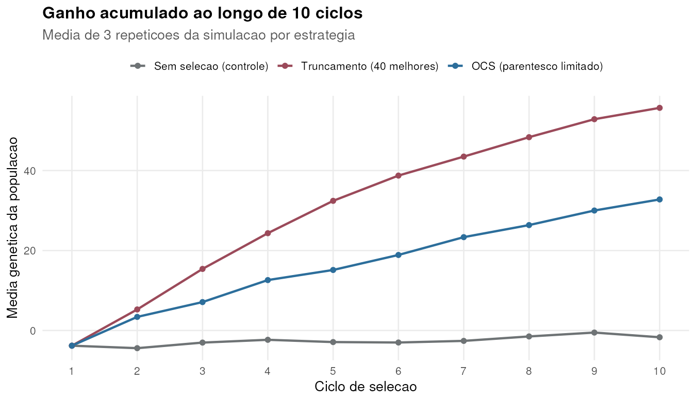
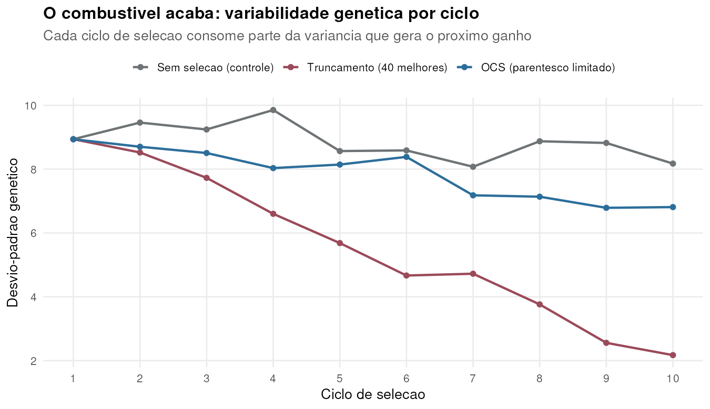
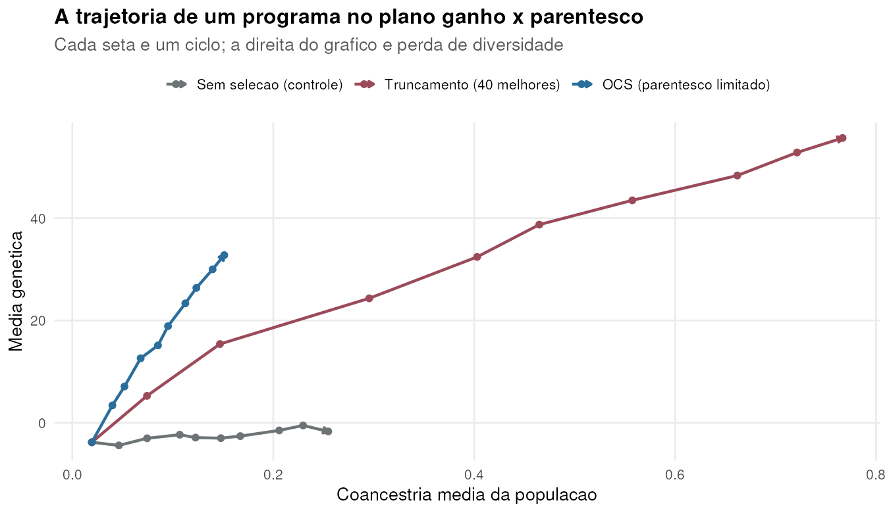
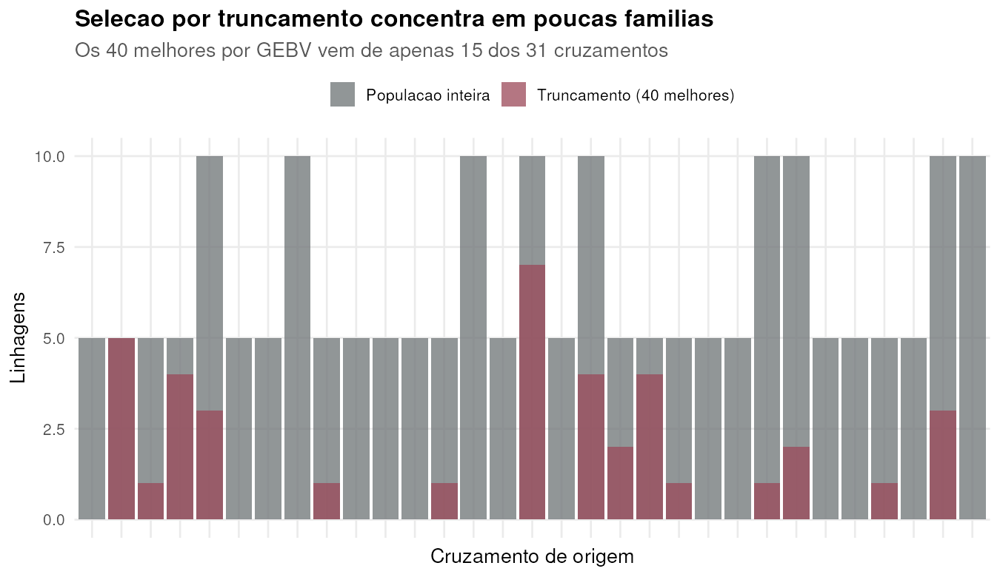
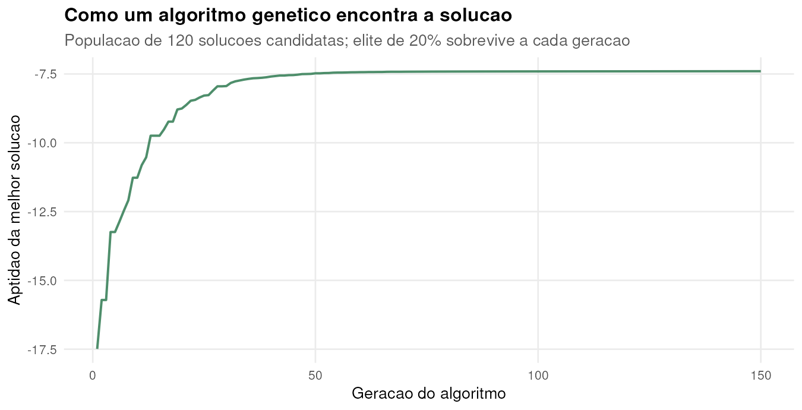
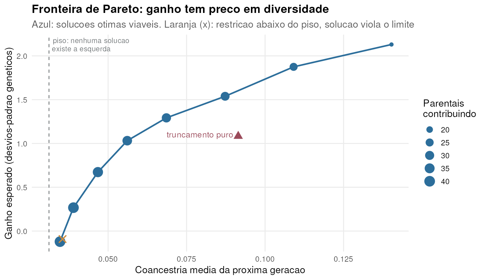
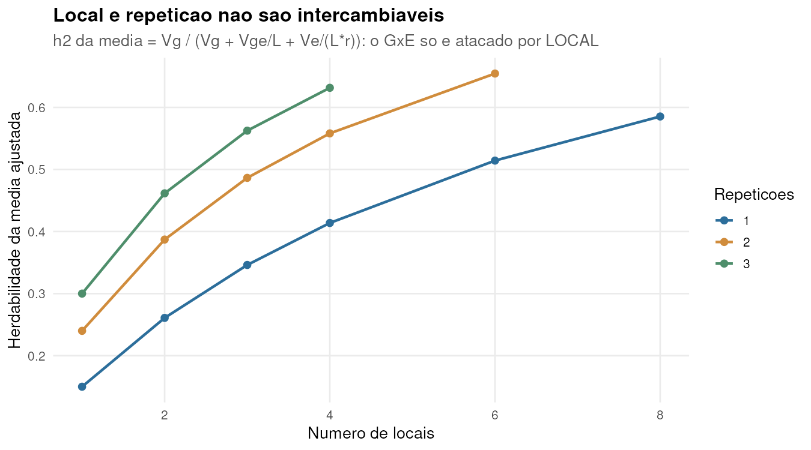
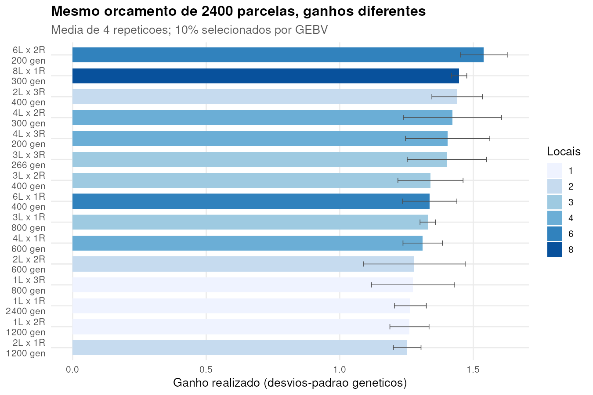

```{r}
#| include: false
#| eval: true
R <- readRDS("resultados_09.rds")
fmt <- function(x, d = 2) formatC(x, format = "f", digits = d, big.mark = ".",
                                  decimal.mark = ",")
c10 <- R$resumo_ciclo10
pega <- function(rot, col) c10[[col]][grepl(rot, c10$estrategia_rot)]
```

## De manhã predizemos. Agora decidimos.

:::: {.columns}
::: {.column width="48%"}
**Item 6 respondeu:**

Quem são os melhores? → GEBV

Com que confiança? → acurácia
:::
::: {.column width="48%"}
**Item 9 pergunta:**

Quem **cruzar** com quem, e quanto?

Quantos locais e repetições o orçamento paga?

E o que acontece **depois de dez ciclos** disso?
:::
::::

::: {.fragment .callout-note}
A diferença é que predição tem resposta certa. Decisão tem **trade-off** — e
trade-off não se resolve com um número, se resolve com uma fronteira.
:::

## Três blocos

::: {.incremental}
1. **Simulação de ciclos** — o que a seleção faz com a população ao longo do tempo
2. **OCS** — escolher contribuições de parentais como problema de otimização
3. **Alocação de recursos** — quantos locais, repetições e genótipos, dado o orçamento
:::

::: {.fragment}
Todos os três têm a mesma estrutura lógica: existe uma **função objetivo**, existem
**restrições**, e a resposta não é óbvia sem rodar.
:::

# Bloco 1 · Simulação de ciclos {background-color="#2C6E9B"}

## Por que simular o programa, e não o ciclo

Um ciclo isolado responde "quanto ganho agora". Dez ciclos revelam algo que nenhuma
análise de ciclo único mostra:

::: {.fragment}
> A seleção consome a variabilidade que gera o próximo ganho.
:::

::: {.fragment}
Isso não é um efeito secundário. É o mecanismo central que decide se um programa
ainda vai estar ganhando em vinte anos.
:::

## O motor, em três linhas conceituais

```{r}
for (ciclo in 1:10) {
  Z  <- dosagem(pop)                       # genotipa
  fe <- fenotipar(valor_genetico(Z, arq), h2 = 0.30)
  G  <- matriz_G(Z, p = fund$p0)           # parentesco na base original
  fit  <- gblup(fe$y[idx_ts], idx_ts, G, (1 - H2) / H2)
  sel  <- escolher(fit$gebv, G, estrategia)  # <- a decisão
  pop  <- cruzar_dh(pop, pais, maes, n_prog = 5, mapa, chr_idx)
}
```

. . .

**Só a linha `escolher` muda** entre as três estratégias que vamos comparar:

- **Sem seleção** — controle: mostra o que é deriva e o que é ganho
- **Truncamento** — os 40 melhores por GEBV, prática usual
- **OCS** — contribuições otimizadas com restrição de parentesco

::: {.notes}
Observar que p0 é fixo nas frequências dos fundadores: isso faz a coancestria ser
medida em relação à base original, que é o que permite comparar ciclos entre si.
:::

## Ganho: truncamento parece imbatível

```{r}
#| eval: true
#| echo: false
#| out-width: "72%"

```

No ciclo 10: truncamento **`r fmt(pega("Truncamento", "media_gen"))`** contra
**`r fmt(pega("OCS", "media_gen"))`** do OCS. Se a aula parasse aqui, a conclusão
seria clara — e errada.

## Diversidade: a conta que chega depois

```{r}
#| eval: true
#| echo: false
#| out-width: "72%"

```

::: {.fragment}
Desvio-padrão genético no ciclo 10: truncamento **`r fmt(pega("Truncamento", "sd_gen"))`**,
OCS **`r fmt(pega("OCS", "sd_gen"))`**. O truncamento queimou o combustível
— e $\Delta G = i \cdot r \cdot \sigma_A / L$ depende de $\sigma_A$.
:::

## As duas curvas no mesmo plano

```{r}
#| eval: true
#| echo: false
#| out-width: "70%"

```

Cada seta é um ciclo. **Para cima** é ganho, **para a direita** é endogamia.
O truncamento sobe rápido e corre para a direita; o OCS sobe menos e quase não
anda para o lado.

## O que a simulação entregou {.smaller}

```{r}
#| eval: true
#| echo: false
knitr::kable(
  data.frame(
    Estratégia = as.character(c10$estrategia_rot),
    `Média genética` = round(c10$media_gen, 1),
    `Desvio genético` = round(c10$sd_gen, 2),
    `Coancestria` = round(c10$coancestria, 3),
    check.names = FALSE),
  align = "lrrr")
```

::: {.incremental}
- O truncamento entrega **`r fmt(100 * (pega("Truncamento", "media_gen") / pega("OCS", "media_gen") - 1), 0)`% mais ganho** em 10 ciclos
- E retém **`r fmt(pega("OCS", "sd_gen") / pega("Truncamento", "sd_gen"), 1)`× menos** variabilidade
- Com coancestria **`r fmt(pega("Truncamento", "coancestria") / pega("OCS", "coancestria"), 1)`× maior**
:::

::: {.fragment .callout-important}
Qual é melhor? **A pergunta está mal formulada.** Depende do horizonte do programa.
Em 10 ciclos o truncamento ganha; o que a simulação permite é ver o preço antes de pagá-lo.
:::

# Bloco 2 · OCS {background-color="#2C6E9B"}

## O problema de otimização

$$\max_{\mathbf{c}} \; \mathbf{c}'\hat{\mathbf{g}} \quad \text{sujeito a} \quad
\frac{\mathbf{c}'\mathbf{A}\mathbf{c}}{2} \le f, \;\; \sum c_i = 1, \;\; c_i \ge 0$$

::: {.incremental}
- $\mathbf{c}$ — **contribuição** de cada candidato para a próxima geração
- $\hat{\mathbf{g}}$ — os GEBV que calculamos de manhã
- $\mathbf{A}$ — parentesco, vindo da matriz G
- $f$ — o limite de endogamia que o programa aceita
:::

::: {.fragment}
**Sem a restrição a solução é trivial e ruim:** todo o peso no melhor indivíduo.
A restrição é o que transforma seleção em otimização.
:::

## Por que a restrição é necessária

```{r}
#| eval: true
#| echo: false
#| out-width: "74%"

```

Os 40 melhores por GEBV vêm de apenas **`r R$familias_truncamento["distintas_sel"]`**
dos `r R$familias_truncamento["distintas_pop"]` cruzamentos. Irmãos completos
selecionando irmãos completos.

## Antes de otimizar: a restrição é viável?

```{r}
piso_coancestria <- function(G, n_iter = 4000, passo = 0.02) {
  A <- G / 2; n <- nrow(A)
  c_ <- rep(1 / n, n)
  for (i in seq_len(n_iter)) {
    gr <- 2 * as.numeric(A %*% c_)
    c_ <- c_ - passo * (gr - mean(gr))   # projeta no hiperplano sum = 1
    c_[c_ < 0] <- 0                      # projeta no ortante positivo
    c_ <- c_ / sum(c_)
  }
  as.numeric(crossprod(c_, A %*% c_))
}
```

::: {.fragment}
Piso nesta população: **`r fmt(R$piso["piso"], 4)`**, usando
`r R$piso["n_ativos"]` contribuintes.
:::

::: {.fragment .callout-warning}
## Erro que este script cometeu
A primeira versão pedia parentesco ≤ 0,020 — **abaixo do piso de `r fmt(R$piso["piso"], 3)`**.
O otimizador não reclamou: devolveu soluções que violavam a restrição, com ganho
negativo. **Restrição inviável não dá erro, dá resultado sem sentido.** Medir o
piso antes é o que separa otimização de chute.
:::

## Algoritmo genético: a busca, em R base

```{r}
aptidao <- function(c_) {
  ganho <- sum(c_ * gz)
  coanc <- as.numeric(crossprod(c_, A %*% c_))
  ganho - max(0, coanc - max_coancestria) * 500   # penaliza violação
}
```

A mesma lógica da seleção natural, aplicada a soluções em vez de plantas:

::: {.incremental}
1. **População** de 120 vetores de contribuição aleatórios
2. **Aptidão** = ganho penalizado pela violação da restrição
3. **Elite** de 20% sobrevive intacta
4. **Recombinação** uniforme entre pares + **mutação** que realoca peso
5. Repete por 150 gerações
:::

## O algoritmo trabalhando

```{r}
#| eval: true
#| echo: false
#| out-width: "68%"

```

::: {.notes}
Penalizar em vez de proibir deixa o AG transitar por regiões inviáveis e voltar,
o que acelera muito a busca. É um truque geral de otimização com restrição.
:::

## A fronteira de Pareto

```{r}
#| eval: true
#| echo: false
#| out-width: "70%"

```

## Lendo a fronteira {.smaller}

```{r}
#| eval: true
#| echo: false
pv <- R$pareto[R$pareto$viavel, c("restricao", "ganho", "coancestria", "n_contribuintes")]
knitr::kable(
  data.frame(
    `Limite de parentesco` = round(pv$restricao, 4),
    `Ganho obtido` = round(pv$ganho, 2),
    `Coancestria` = round(pv$coancestria, 4),
    `Parentais` = pv$n_contribuintes,
    check.names = FALSE),
  align = "rrrr")
```

::: {.incremental}
- **Relaxar a restrição sempre aumenta o ganho** — não existe almoço grátis
- **Quanto mais apertada, mais parentais contribuem**: de
  `r min(pv$n_contribuintes)` a `r max(pv$n_contribuintes)`
- Nenhum ponto é "o certo". A escolha depende do horizonte do programa —
  e é uma **decisão de negócio**, não de estatística
:::

## Validação: implementação própria exige conferência

:::: {.columns}
::: {.column width="50%"}
**optiSel** (pacote público)

ganho `r fmt(R$optisel$optisel["ganho"], 3)`

coancestria `r fmt(R$optisel$optisel["coancestria"], 4)`

`r R$optisel$optisel["n"]` contribuintes
:::
::: {.column width="50%"}
**AG em R base** (50 linhas)

ganho `r fmt(R$optisel$ga["ganho"], 3)`

coancestria `r fmt(R$optisel$ga["coancestria"], 4)`

`r R$optisel$ga["n"]` contribuintes
:::
::::

::: {.fragment}
A coancestria é **idêntica** — os dois saturam a restrição, como esperado. O optiSel
extrai `r fmt(100 * (R$optisel$optisel["ganho"] / R$optisel$ga["ganho"] - 1), 1)`% mais
ganho no mesmo limite, porque usa um solver de programação quadrática em vez de busca
estocástica.
:::

::: {.fragment .callout-tip}
**Escrever o seu é como entender.** Usar o pacote é como produzir. Se os dois
divergem muito, o errado é quase sempre o seu — e descobrir isso é o ponto.
:::

# Bloco 3 · Alocação de recursos {background-color="#2C6E9B"}

## O orçamento real de um programa é medido em parcelas

Com `r format(R$parametros$orcamento, big.mark = ".")` parcelas, três usos competem:

::: {.incremental}
- **Mais genótipos** → mais intensidade de seleção ($i$ maior)
- **Mais locais** → melhor estimativa frente ao GxE
- **Mais repetições** → menos erro experimental dentro do local
:::

::: {.fragment}
$$n_{gen} \times n_{loc} \times n_{rep} \le \text{orçamento}$$

A pergunta "quantos locais?" só tem resposta **porque o orçamento é fixo**.
Sem restrição, a resposta é sempre "mais de tudo".
:::

## Local e repetição não são intercambiáveis

$$h^2_{\bar{y}} = \frac{\sigma^2_g}{\sigma^2_g + \dfrac{\sigma^2_{ge}}{L} + \dfrac{\sigma^2_e}{L \cdot r}}$$

::: {.fragment}
Olhe onde cada termo aparece: **repetição ($r$) só divide o erro residual**.
**Local ($L$) divide o erro E o GxE.**
:::

::: {.fragment}
Quando há interação genótipo × ambiente — e em produtividade sempre há — repetir no
mesmo local **não resolve** o problema que mais atrapalha.
:::

## {.smaller}

```{r}
#| eval: true
#| echo: false
#| out-width: "72%"

```

Note que as curvas de 2 e 3 repetições estão **próximas**, enquanto subir de 1 para
4 locais muda muito mais. A segunda repetição vale menos que o segundo local.

## O resultado, com o orçamento fixo

```{r}
#| eval: true
#| echo: false
#| out-width: "64%"

```

## A melhor e a pior escolha {.smaller}

```{r}
#| eval: true
#| echo: false
top <- head(R$alocacao[order(-R$alocacao$ganho), ], 5)
knitr::kable(
  data.frame(
    Locais = top$n_loc, Repetições = top$n_rep, Genótipos = top$n_gen,
    `h² da média` = round(top$h2_media, 2),
    Acurácia = round(top$acuracia, 3),
    `Ganho realizado` = round(top$ganho, 3),
    check.names = FALSE),
  align = "rrrrrr")
```

::: {.fragment}
**Melhor:** `r R$alocacao_extremos$melhor$n_loc` locais ×
`r R$alocacao_extremos$melhor$n_rep` repetições ×
`r R$alocacao_extremos$melhor$n_gen` genótipos → ganho
**`r fmt(R$alocacao_extremos$melhor$ganho, 3)`**

**Pior:** `r R$alocacao_extremos$pior$n_loc` locais ×
`r R$alocacao_extremos$pior$n_rep` repetições ×
`r R$alocacao_extremos$pior$n_gen` genótipos → ganho
**`r fmt(R$alocacao_extremos$pior$ganho, 3)`**
:::

::: {.fragment .callout-note}
**`r fmt(100 * (1 - R$alocacao_extremos$pior$ganho / R$alocacao_extremos$melhor$ganho), 0)`% de diferença
no ganho, com exatamente o mesmo custo.** O extremo de muitos genótipos com uma
parcela só perde: a intensidade de seleção sobe, mas a acurácia cai mais rápido.
:::

## O que os três blocos têm em comum

::: {.incremental}
1. **Uma função objetivo explícita** — escrita, não implícita na intuição
2. **Restrições que mordem** — orçamento, parentesco, piso de viabilidade
3. **Um resultado que não era óbvio** antes de rodar
:::

::: {.fragment}
É isto que distingue otimização de preferência pessoal: a preferência fica na função
objetivo, onde pode ser discutida. O resto é cálculo.
:::

## Onde a IA entra

:::: {.columns}
::: {.column width="50%"}
**Acelera muito**

- Escrever o AG e o motor de simulação
- Traduzir a restrição em código
- Varrer uma grade de cenários
- Diagnosticar "por que o otimizador devolveu isso"
- Gerar as figuras de comparação
:::
::: {.column width="50%"}
**Não substitui você**

- Definir a função objetivo
- Saber que a restrição era inviável
- Perceber que o OCS "perdendo diversidade" era bug
- Escolher o ponto na fronteira
- Defender a decisão
:::
::::

::: {.fragment .callout-important}
Os dois erros reais deste script — restrição abaixo do piso e restrição relativa que
nunca mordia — **passaram sem nenhuma mensagem de erro**. Foram pegos olhando a
figura e achando o resultado biologicamente implausível. Nenhuma IA faria isso por
você, porque exige saber o que esperar.
:::

## Exercício · 25 minutos

**Peça a um assistente de IA:**

> Em R base, implemente um algoritmo genético que escolha contribuições de 100
> parentais maximizando o ganho genético médio, sujeito à restrição de que a
> coancestria média da próxima geração não passe de 0,05. As contribuições devem
> somar 1 e ser não-negativas. Simule os dados de entrada.

::: {.fragment}
**Depois, as perguntas que importam:**

1. Ele verificou se 0,05 é **viável** para a matriz que gerou? (quase certamente não)
2. Como ele tratou a restrição: penalização, projeção, ou ignorou?
3. As contribuições somam 1 **ao final**, depois da mutação?
4. Peça a fronteira variando o limite. A curva é **monotônica**? Se não, o
   otimizador não convergiu.
:::

## O que levar das duas aulas

::: {.incremental}
1. **GEBV responde "quem"** — otimização responde "quanto de cada um"
2. **Ganho e diversidade são um trade-off**, com fronteira explícita
3. **Restrição inviável não dá erro** — dá resultado errado em silêncio
4. **Local ≠ repetição** quando existe GxE
5. **Mesmo orçamento, ganhos muito diferentes** — a alocação é decisão de projeto
6. **Simular é o único jeito de ver o preço** de uma decisão antes de pagá-lo
:::

## {.center}

### Obrigado

::: {.smaller}
Todo o material desta aula — simulador, GBLUP, OCS, alocação — é **R base**,
sem pacotes proprietários, com dados **100% simulados** e semente fixa.

Rode, modifique, quebre. É assim que se aprende.
:::
